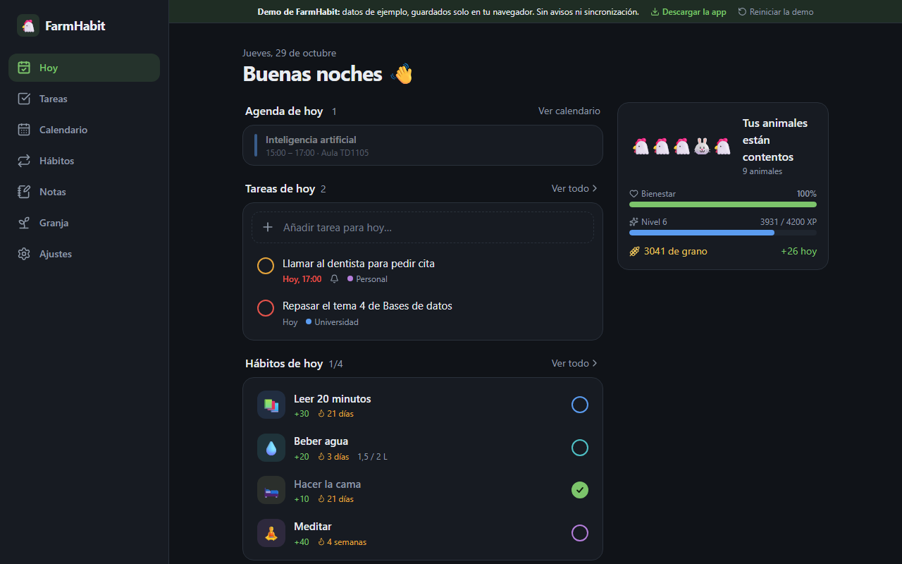
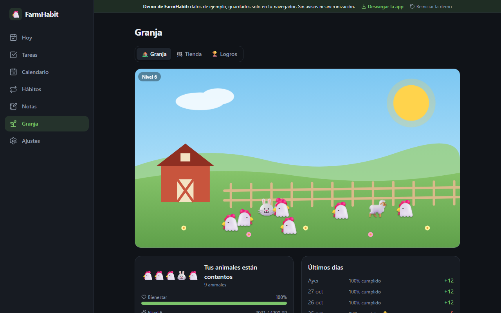
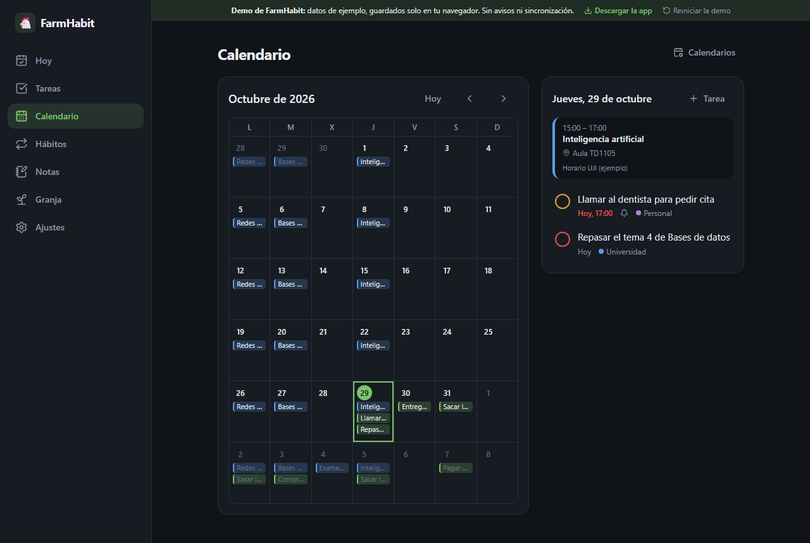
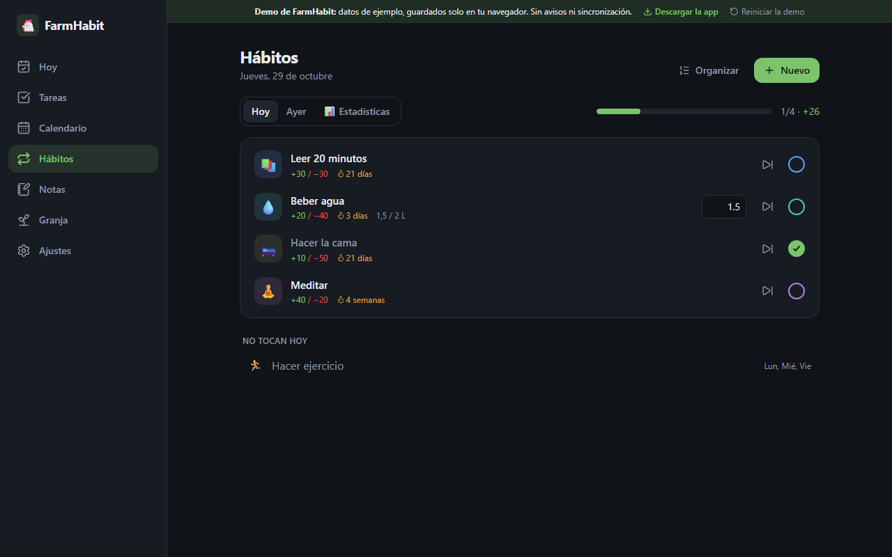
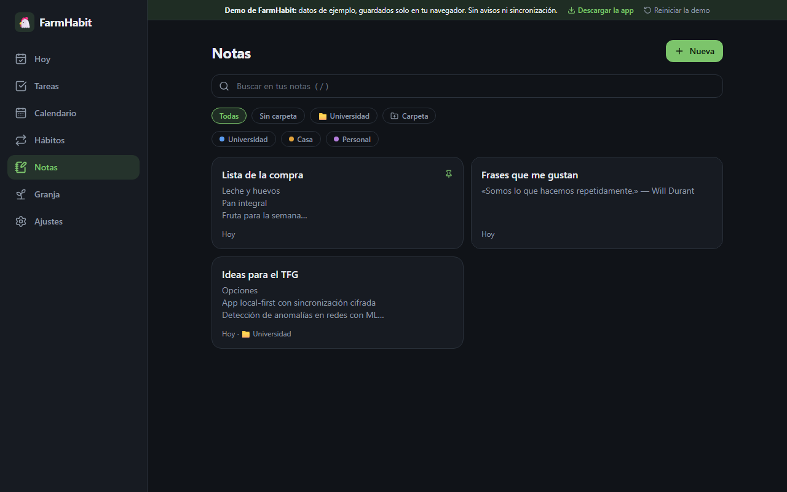
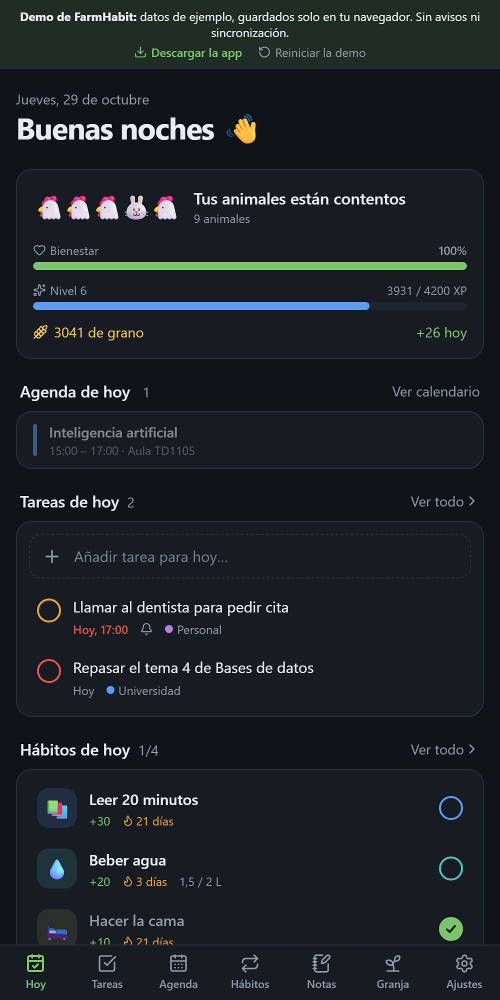

# 🐔 FarmHabit

**Tareas, hábitos y notas en una sola app, con una granja que depende de ti.**

FarmHabit es una app de productividad personal _local-first_ para **Windows, Linux y Android**. Cada hábito que cumples hace crecer tu granja; si los descuidas, tus animales enferman… y pueden morir para siempre.

Tus datos se guardan en tu dispositivo, sin cuentas propias ni servidores. Si quieres usarla en varios dispositivos, se sincronizan cifrados a través de tu Google Drive.

**[▶ Probar la demo en el navegador](https://adelledgar.github.io/farmhabit/)** · **[⬇ Descargar](https://github.com/AdellEdgar/farmhabit/releases/latest)** · Interfaz en español

<p align="center">
  
</p>

<p align="center">
  
  
</p>

<p align="center">
  
  
  
</p>

## Qué puedes hacer

### ✅ Tareas

- Prioridad (alta, media, baja), etiquetas de colores, fecha límite y hora.
- Tareas que se repiten: cada día, ciertos días de la semana, cada mes, el último día del mes…
- **Varios avisos por tarea**: 1 semana antes, 1 día antes, 1 hora antes, a la hora…
- Vistas **Hoy**, **Próximas**, **Todas** y **Completadas**; orden por fecha o _inteligente_, que combina urgencia y prioridad.

### 🔁 Hábitos

- Frecuencias: cada día, días concretos, N veces por semana o por mes, cada N días.
- Hábitos con **cantidad** (2 L de agua, 8000 pasos) y puntos parciales.
- Marcar como **saltado** (no rompe la racha), rachas y recordatorios configurables.
- Orden manual por importancia.
- **Estadísticas:** gráfica de cumplimiento de los últimos 30 días y, por hábito, un calendario coloreado al estilo de GitHub con su racha actual, su mejor racha y su porcentaje.

### 🐔 La granja

- Cada hábito tiene una **importancia** del 1 al 5. Hacerlo suma `10 × importancia` puntos; no hacerlo resta `10 × (6 − importancia)`. **Fallar lo fácil penaliza más.**
- La **XP** solo sube y hace crecer la granja de nivel. El **bienestar** sube o baja cada día según cuánto cumples.
- Con el bienestar bajo, los animales **enferman** y, tras 3 días malos, **mueren** (te avisa antes, con su nombre). Curarlos exige 2 días buenos seguidos.
- Reglas contra trampas: solo se puede apuntar hoy y ayer, los hábitos recién creados no cuentan para recuperar y borrar un hábito no borra sus penalizaciones.
- **Modo vacaciones**, activado por adelantado.
- Una **escena animada** de tu granja: el tiempo cambia con el bienestar (sol, nubes o lluvia) y los animales pasean, o se ven enfermos.
- **Tienda** para comprar animales con el grano ganado (gallinas, conejos, ovejas… hasta caballos en el nivel 10), **crías** que nacen solas, **logros** y un **cementerio** con los que no sobrevivieron.

### 📝 Notas

- Editor visual (títulos, listas, casillas, citas, código), carpetas, etiquetas, notas fijadas y buscador que ignora acentos.
- **Notas privadas** 🔒 con su propia contraseña y una capa extra de cifrado. Se bloquean solas a los 5 minutos sin usarlas.

### 🗓️ Calendario

- Vista de **mes** con tus tareas (también las repeticiones futuras) y el detalle de cada día.
- Muestra junto a tus tareas el calendario de la **universidad**, **Google**, **Outlook** o **iCloud**: puedes suscribirte con su enlace iCal (se actualiza solo) o importar un archivo `.ics`. Solo se leen, nunca se modifican. Cómo conseguir el enlace: [docs/calendarios.md](docs/calendarios.md).
- La pantalla **Hoy** muestra la agenda del día.

### 🎨 Temas

- 7 temas (Noche, Día, Bosque, Océano, Atardecer, Lavanda, Granja), seguir el modo claro/oscuro del sistema o **crear el tuyo** eligiendo 4 colores, con vista previa en directo.

### 🔔 Avisos

- Notificaciones del sistema para tareas, hábitos y la granja.
- En escritorio, la app puede quedarse en la **bandeja del sistema** y **arrancar con el ordenador**. En Android, los avisos se programan con antelación.

### ☁️ Sincronización y copias

- **Sincronización automática con Google Drive.** Usa una carpeta oculta, solo de la app, y los datos se **cifran en tu dispositivo** con tu frase secreta: Google no puede leerlos.
- **Copias de seguridad** en un archivo `.agx` cifrado con contraseña. Al importarlas se fusionan con tus datos sin perder nada.

## Descargar

Los instaladores de cada versión están en **[Releases](https://github.com/AdellEdgar/farmhabit/releases/latest)**:

| Plataforma    | Archivo                         | Notas                                                                                                                       |
| ------------- | ------------------------------- | --------------------------------------------------------------------------------------------------------------------------- |
| Windows 10/11 | `FarmHabit_x.y.z_x64-setup.exe` | Sin firma digital: Windows mostrará "SmartScreen: aplicación desconocida" → _Más información_ → _Ejecutar de todas formas_. |
| Linux         | `.AppImage` o `.deb`            | AppImage: `chmod +x FarmHabit*.AppImage` y ejecutar. El `.deb` instala las dependencias solo.                               |
| Android       | `FarmHabit_x.y.z_android.apk`   | Permite "instalar apps de origen desconocido". Ver [docs/android.md](docs/android.md).                                      |

¿Solo quieres echar un vistazo? La **[demo web](https://adelledgar.github.io/farmhabit/)** es la misma app con datos de ejemplo, que se guardan solo en tu navegador. No tiene avisos ni sincronización.

Lo nuevo de cada versión está en el [CHANGELOG](CHANGELOG.md).

## Privacidad y seguridad

- **Sin servidores propios ni cuentas de FarmHabit.** La base de datos (SQLite) vive en tu dispositivo.
- **Cifrado con [libsodium](https://doc.libsodium.org/):** Argon2id para derivar claves y XChaCha20-Poly1305 para cifrar. No hay criptografía casera.
- **La frase secreta y las contraseñas nunca se guardan.** Para sincronizar se guarda solo la clave derivada, en el llavero del sistema (Credential Manager en Windows, Secret Service en Linux).
- **Acceso mínimo a Google Drive** (`drive.appdata`): solo la carpeta de la app, no el resto de tus archivos.

## Desarrollo

**Requisitos:** Node 22.13+, pnpm 10, Rust (rustup) y:

- **en Windows**, las Build Tools de C++ de Visual Studio;
- **en Linux**, `libwebkit2gtk-4.1-dev libayatana-appindicator3-dev librsvg2-dev` (ver los [requisitos de Tauri](https://v2.tauri.app/start/prerequisites/)).

```bash
pnpm install
pnpm dev          # app de escritorio en modo desarrollo
pnpm dev:web      # solo la interfaz, en el navegador (http://localhost:1420; añade ?demo para datos de ejemplo)
pnpm check        # tipos + lint + formato + tests
pnpm build        # instalador de tu sistema
```

La sincronización necesita credenciales de Google propias: sigue [docs/google-drive.md](docs/google-drive.md). Sin ellas, todo lo demás funciona.

### Arquitectura

```
packages/core/   Núcleo en TypeScript, sin interfaz: modelo, SQLite, motor de la granja,
                 cifrado, formato .agx, fusión y sincronización. ~185 tests (Vitest + fast-check).
apps/app/        Interfaz en React 19 + Tailwind 4, empaquetada con Tauri 2.
  src-tauri/     Rust mínimo: SQLite nativo con transacciones atómicas, llavero del sistema,
                 inicio de sesión con Google y bandeja del sistema.
```

- **Local-first con fusión determinista:** cada elemento tiene UUID, `updatedAt` y marca de borrado. Al sincronizar gana el cambio más reciente; la fusión es conmutativa, asociativa e idempotente, y lo comprueban tests de propiedades.
- **La granja se calcula, no se guarda:** el estado sale de reproducir el historial de hábitos día a día, así todos los dispositivos ven exactamente la misma granja.

Para publicar una versión nueva: sube la versión en `apps/app/package.json` (y en los demás `package.json` y en `Cargo.toml`), apúntala en el CHANGELOG y crea la etiqueta, por ejemplo `git tag v1.0.1 && git push --tags`. GitHub Actions compila todo y publica la Release.

## Cómo se hizo

FarmHabit lo he construido por fases con un asistente de IA (Claude) como "desarrollador principal": yo decidía el producto, las reglas y las prioridades, revisaba cada fase y hacía los commits. Las decisiones de diseño, el formato del archivo y todas las reglas del juego están en [CLAUDE.md](CLAUDE.md), que también sirve de guía para seguir desarrollándola.

| Fase | Contenido                                                    |
| ---- | ------------------------------------------------------------ |
| 0    | Estructura del monorepo, Tauri y plan                        |
| 1    | Núcleo: modelo, SQLite, motor de la granja, cifrado y fusión |
| 2    | Interfaz: Hoy, Tareas, Hábitos, Notas y Ajustes              |
| 3    | Avisos, bandeja del sistema y arranque automático            |
| 4    | Sincronización con Google Drive y copias de seguridad        |
| 5    | Linux, Android y compilación en GitHub Actions               |
| 6    | Granja visual, notas privadas, estadísticas y temas          |
| 7    | Calendario y suscripción a calendarios `.ics`                |
| 8    | Publicación: versión 1.0.0, Releases y demo web              |

## Licencia

[MIT](LICENSE) © 2026 AdellEdgar
